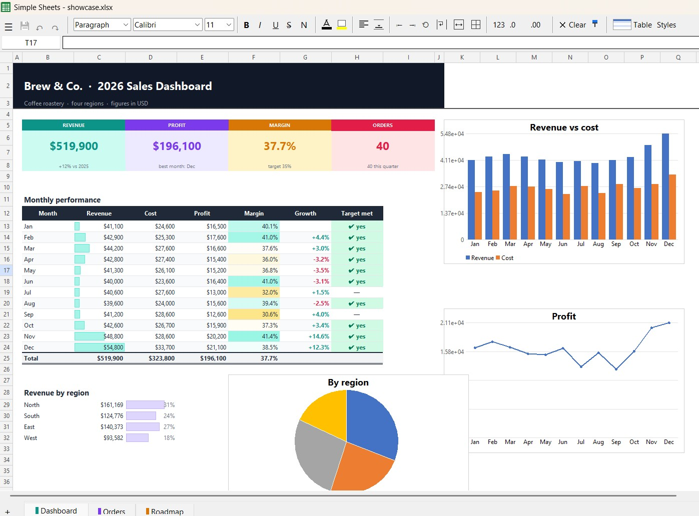
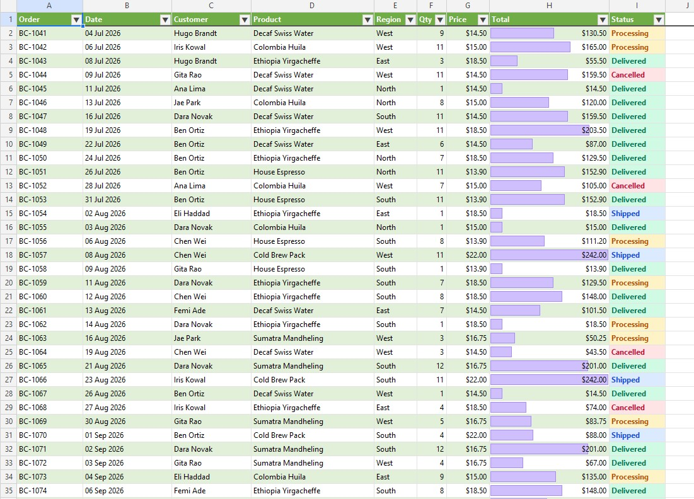
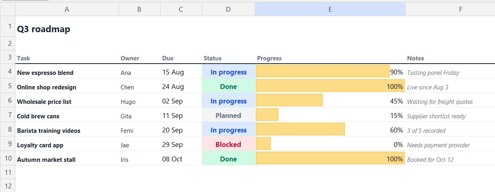

# Simple Sheets

**A fast, lightweight spreadsheet app for Windows.** Opens Excel, OpenDocument and CSV files in a blink,
edits them like the spreadsheet you already know, and saves them back without wrecking their formatting.
One 20 MB program, no Office licence, no account, no cloud required.



---

## Why Simple Sheets?

- **Starts instantly.** The window is ready in about a third of a second, even on a modest laptop.
  Big files load in the background with a progress bar, so you're never stuck staring at a frozen window.
- **Your files stay your files.** Saving changes only what you changed. Formatting, charts, pictures,
  shapes, sparklines, pivot tables, comments, protection and passwords all survive a round trip, and it
  tells you plainly before anything it can't keep would be lost.
- **Feels familiar on day one.** Formula bar, fill handle, Ctrl+A to select the data, right-click to insert rows,
  sheet tabs at the bottom, Ctrl+Z for everything. If you've used Excel or Google Sheets, there's nothing to learn.
- **Light on your machine.** Pure Python with three small libraries, packed into a single exe.
  No background services, no telemetry, nothing installed system-wide (per-user install, no admin rights).
- **Built to be trusted.** 800+ automated tests run on every change, including real files opened, saved and
  compared part by part.

## See it in action

**Tables that look like they were designed:** Excel table styles with banding and filter buttons,
colour-coded statuses and in-cell data bars.



**Project tracking at a glance:** conditional formatting, progress bars and clean typography,
straight from the file.



> The sample workbook is in [`docs/showcase.xlsx`](docs/showcase.xlsx); rebuild it with `python tools/make_showcase.py`.

## What it can do

### Files
- Opens **.xlsx, .xlsm, .xlsb, .xls, .ods, .csv, .tsv** and Excel templates; saves .xlsx, .xlsb, .ods and .csv
- **Password-protected workbooks**: opens them, and saves them encrypted again with the same password
- **Export to PDF** (this sheet, all sheets or just the selection) with a **print preview**, page breaks,
  print areas and repeated title rows; export to HTML
- Import a **CSV with a preview wizard** (encoding, delimiter, column types) or **a table straight from a web page**
- **Compare two workbooks** cell by cell
- Several workbooks in **tabs** in one window, a split view, drag & drop from Explorer
- Notices when a file changed on disk, is locked by Excel, or has **OneDrive / Dropbox / Google Drive conflict copies**
- **Crash-safe:** unsaved work is kept every minute and offered back after a crash

### Formulas
- **Nearly 200 functions**, including XLOOKUP, FILTER, SORT, UNIQUE, SEQUENCE, LET, LAMBDA, MAP, REDUCE, XMATCH,
  dynamic arrays that spill, cross-sheet and cross-workbook references, named ranges and structured table refs
- Smart recalculation (only what an edit affects), iterative calculation, manual mode (F9)
- Autocomplete with argument hints, references coloured as you type, **Insert function** with examples,
  and **Evaluate formula** step by step

### Formatting
- Fonts, colours, borders, alignment, rotation, indent, wrap, merge, number formats, rich text in a cell
- **Table styles**, **conditional formatting** (colour scales, data bars, rules) and **data validation** drop-downs
- Format painter, quick styles (title, heading, paragraph), freeze panes, hide rows / columns / sheets, groups

### Data & analysis
- Sort (including your own orders like Low → Medium → High), filter by value, condition or **colour**,
  **advanced filter**, remove duplicates, text to columns, **flash fill**
- **Pivot tables** saved as real Excel pivot tables, **charts** (column, bar, line, pie, area) you can move,
  resize and edit, **pictures**
- **What-if tools:** goal seek, scenario manager, data tables and a solver with constraints
- Find & replace across all sheets with a "find all" list, threaded comments, hyperlinks

### Comfortable to use
- **Command palette (Ctrl+Shift+P):** type a few letters to run any command
- **Dark mode**, **high-contrast mode**, adjustable interface size, colour-blind-safe chart colours
- Fully usable from the **keyboard**: menus, dialogs, sheet tabs, even moving charts and pictures
- English, Bahasa Indonesia and Español, and you can add your own language with a small JSON file
- Spell check (F7), zoom (Ctrl + wheel), full screen (F11)

## Get it

1. Download **`SimpleSheets-Setup.exe`** and run it. No admin rights needed; it adds a Start menu entry and
   "Open with" for spreadsheet files, and cleanly replaces any older version.
2. Prefer no install? Use **`SimpleSheets-portable.zip`**: unzip anywhere (even a USB stick) and run.
   Settings stay next to the program.
3. For IT departments: `SimpleSheets-Setup.exe /S` installs silently (`/D=folder`, `/desktop`, `/noopenwith`).

Updates can be checked and installed automatically (Tools → Settings); every download is verified with
its SHA-256 checksum before it runs.

## Build from source

```bat
pip install -r requirements-dev.txt
python simple_sheets.py [file]      &rem run it
python -m pytest                    &rem 800+ tests, about 30 seconds
build.bat                           &rem dist\SimpleSheets.exe, the installer and the portable zip
```

Runtime dependencies: Python's standard library, `openpyxl` and `xlrd`, nothing else.
Linux and macOS build scripts (`build.sh` → `.deb`, `.app` / `.dmg`) are included but still experimental.

## Status

Version **2.0.0**. Every item of the first two roadmaps is done; see [ROADMAP.md](ROADMAP.md).
Still to come: a code-signed installer, keeping Excel slicers, and real screen-reader support
([study](docs/accessibility-study.md)).
